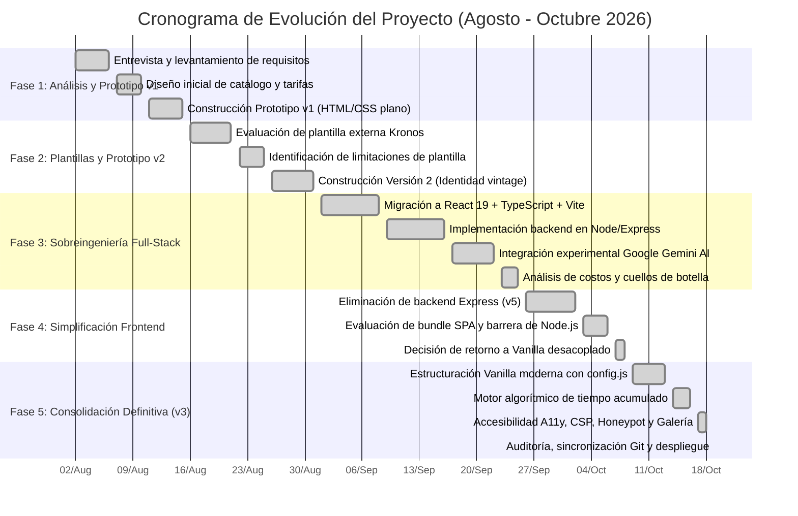

# CRONOGRAMA DE ACTIVIDADES DEL PROYECTO
### *Plataforma Web y Sistema de Agendamiento - Barbería El Arriero Ilustrado*
**Plantilla de Referencia:** `ICSimpleProjectTimelineTemplateforExcel11412_ES.xlsx`  
**Responsable Asignado:** Johan Steven Ibarra Angulo  
**Fecha de Inicio:** 2 de agosto de 2026  
**Fecha de Cierre:** 19 de octubre de 2026  
**Duración Total:** 11 semanas (57 días hábiles de desarrollo e iteración)  
**Estado General:** Completo (100%)  

---

## 1. Visualización del Cronograma (Diagrama de Gantt)

---

## 2. Matriz Detallada de Tareas y Subtareas (Formato Excel Plantilla)

| # | Fase / Tarea Principal | Subtarea Específica | Estado | Asignada a | Fecha de Inicio | Fecha de Finalización | Duración (Días) | Comentarios Técnicos y Observaciones |
| :-: | :--- | :--- | :---: | :---: | :---: | :---: | :-: | :--- |
| **1.0** | **FASE 1: Levantamiento y Primer Prototipo** | **Análisis exploratorio del negocio** | **Completo** | Johan Ibarra | 02/08/2026 | 15/08/2026 | 14 | Fase de entendimiento de la operación de Barbería El Arriero Ilustrado en El Tiple. |
| 1.1 | Levantamiento de requisitos | Entrevista con el barbero y definición de servicios y precios | Completo | Johan Ibarra | 02/08/2026 | 06/08/2026 | 5 | Se consolida la lista de cortes, afeitados, barbas y color. |
| 1.2 | Diseño de arquitectura inicial | Definición de estructura HTML5 semántica y paleta cromática | Completo | Johan Ibarra | 07/08/2026 | 10/08/2026 | 4 | Elección de verdes oscuros, latón y fondo crema/hueso. |
| 1.3 | Construcción Prototipo v1 | Maquetación web estática básica (`Barbería El Arriero Ilustrado`) | Completo | Johan Ibarra | 11/08/2026 | 15/08/2026 | 5 | Primera versión funcional probada en navegador local. |
| **2.0** | **FASE 2: Exploración de Frameworks y Plantillas** | **Evaluación de alternativas prefabricadas** | **Completo** | Johan Ibarra | 16/08/2026 | 31/08/2026 | 16 | Comparación entre código propio y plantillas del mercado. |
| 2.1 | Pruebas con plantilla Kronos | Despliegue de `kronos-barberia-may` con Tailwind CDN | Completo | Johan Ibarra | 16/08/2026 | 21/08/2026 | 6 | Plantilla rígida con estilos difíciles de adaptar a la cultura local. |
| 2.2 | Análisis de fricción técnica | Auditoría de código muerto y dependencias de la plantilla | Completo | Johan Ibarra | 22/08/2026 | 25/08/2026 | 4 | Se descarta Kronos por falta de flexibilidad en servicios de color. |
| 2.3 | Desarrollo de Versión 2 | Reescritura propia mejorada (`Barberia El Arriero Ilustado 2`) | Completo | Johan Ibarra | 26/08/2026 | 31/08/2026 | 6 | Incorporación de secciones claras para hombres, damas y colorimetría. |
| **3.0** | **FASE 3: La Etapa de Sobreingeniería Full-Stack** | **Exploración de React, Express y GenAI** | **Completo** | Johan Ibarra | 01/09/2026 | 25/09/2026 | 25 | Intento de convertir el proyecto en una plataforma enterprise. |
| 3.1 | Setup de SPA moderna | Configuración de React 19 + TypeScript + Vite (`v3.1`) | Completo | Johan Ibarra | 01/09/2026 | 08/09/2026 | 8 | Creación de componentes modulares y sistema de tipado. |
| 3.2 | Desarrollo de Backend | Servidor Express.js con Node, dotenv y routing REST | Completo | Johan Ibarra | 09/09/2026 | 16/09/2026 | 8 | Configuración de endpoints POST para recibir citas. |
| 3.3 | Integración con Inteligencia Artificial | Implementación del SDK `@google/genai` (Gemini API) | Completo | Johan Ibarra | 17/09/2026 | 22/09/2026 | 6 | Asesor virtual de estilos de corte mediante procesamiento LLM. |
| 3.4 | Auditoría de costos y sostenibilidad | Evaluación de costos en la nube y viabilidad operativa | Completo | Johan Ibarra | 23/09/2026 | 25/09/2026 | 3 | **Conclusión crítica:** El costo de servidores y APIs es insostenible para una barbería local. |
| **4.0** | **FASE 4: Simplificación y Desacoplamiento** | **Retiro de sobreingeniería** | **Completo** | Johan Ibarra | 26/09/2026 | 08/10/2026 | 13 | Pivot hacia la ligereza y el enfoque client-side. |
| 4.1 | Creación de `v5_simplificado` | Eliminación de Express y Gemini; SPA pura en React | Completo | Johan Ibarra | 26/09/2026 | 02/10/2026 | 7 | Los datos se mueven a `barberData.ts` y las citas van a WhatsApp. |
| 4.2 | Evaluación de fricción de mantenimiento | Análisis de la necesidad de Node.js para editar precios | Completo | Johan Ibarra | 03/10/2026 | 06/10/2026 | 4 | El cliente no puede editar precios si depende de `npm run build`. |
| 4.3 | Decisión Arquitectónica Definitiva | Formulación del retorno a Vanilla Web desacoplado | Completo | Johan Ibarra | 07/10/2026 | 08/10/2026 | 2 | Se adopta el principio KISS: Frontend puro sin dependencias. |
| **5.0** | **FASE 5: Consolidación Definitiva (v3 en Producción)** | **Perfeccionamiento, Accesibilidad y Despliegue** | **Completo** | Johan Ibarra | 09/10/2026 | 19/10/2026 | 11 | Construcción de la versión final robusta, accesible y segura. |
| 5.1 | Construcción de `Barberia_El_Arriero_v3` | Arquitectura Vanilla con archivo de parámetros `config.js` | Completo | Johan Ibarra | 09/10/2026 | 13/10/2026 | 5 | Separación absoluta entre la configuración comercial y el código. |
| 5.2 | Algoritmo acumulativo de disponibilidad | Lógica de cálculo de tiempo total y descarte de horas solapadas | Completo | Johan Ibarra | 14/10/2026 | 16/10/2026 | 3 | Garantiza que citas largas (4 h) no se agenden al borde del cierre. |
| 5.3 | Seguridad, Accesibilidad y Galería | Implementación de CSP, Honeypot, WAI-ARIA y lightbox modal | Completo | Johan Ibarra | 17/10/2026 | 18/10/2026 | 2 | Cumplimiento de WCAG 2.1 AA y protección contra bots de spam. |
| 5.4 | Sincronización en Git y Cierre | Resolución de credenciales en GitHub y documentación final | Completo | Johan Ibarra | 19/10/2026 | 19/10/2026 | 1 | Commit y push formal en el repositorio institucional `politecnico-superior`. |
