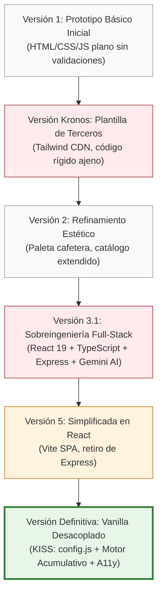
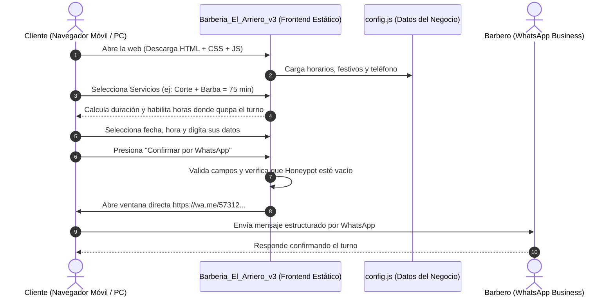

# Corporación Unificada de Educación Superior - CUN / Politécnico
## Facultad de Ingeniería y Ciencias Básicas
### Programa de Ingeniería de Sistemas

---

# INFORME TÉCNICO DE EVOLUCIÓN ARQUITECTÓNICA Y DESARROLLO DE SOFTWARE: PLATAFORMA WEB DE GESTIÓN Y AGENDAMIENTO PARA "BARBERÍA EL ARRIERO ILUSTRADO"
### *De la Sobreingeniería Tecnológica a la Eficiencia Pragmática y Sostenible*

**Autor:** Johan Steven Ibarra Angulo  
**Semestre:** Segundo Semestre (2°)  
**Asignatura:** Refinamiento de Software / Auditoría de Sistemas  
**Docente / Tutor:** Dirección Académica  
**Fecha de Inicio del Proyecto:** 2 de agosto de 2026  
**Fecha de Presentación:** 19 de octubre de 2026  
**Lugar:** El Tiple, Candelaria, Valle del Cauca, Colombia  

---

## Control de Versiones del Documento

| Versión | Fecha | Descripción de Cambios | Autor |
| :--- | :--- | :--- | :--- |
| **1.0** | 15/08/2026 | Documentación de requisitos iniciales y primer prototipo en HTML/CSS plano (`Barbería El Arriero Ilustrado`). | Johan Steven Ibarra Angulo |
| **2.0** | 31/08/2026 | Análisis comparativo de plantillas externas (`kronos-barberia-may`) y prototipo `v2` con identidad visual cafetera. | Johan Steven Ibarra Angulo |
| **3.0** | 25/09/2026 | Especificación técnica de la arquitectura full-stack con React 19, Express y Google GenAI API (`v3.1`). | Johan Steven Ibarra Angulo |
| **4.0** | 08/10/2026 | Evaluación de impacto de sobreingeniería y prototipo SPA desacoplado en Vite (`v5_simplificado`). | Johan Steven Ibarra Angulo |
| **5.0** | 19/10/2026 | Consolidación arquitectónica definitiva: Solución Vanilla desacoplada (`v3`), seguridad CSP, accesibilidad y despliegue. | Johan Steven Ibarra Angulo |

---

## Tabla de Contenido

1. **Resumen Ejecutivo (Abstract)**
2. **Introducción y Contexto del Negocio**
3. **Planteamiento del Problema y Justificación**
   - 3.1. Situación Actual de la Barbería
   - 3.2. Justificación Técnica y Económica
4. **Objetivos del Proyecto**
   - 4.1. Objetivo General
   - 4.2. Objetivos Específicos
5. **Alcance, Suposiciones y Restricciones**
   - 5.1. Alcance Funcional
   - 5.2. Suposiciones de Operación
   - 5.3. Restricciones Técnicas
6. **Análisis Crítico y Evolución de Versiones (El Núcleo Arquitectónico)**
   - 6.1. Iteración 1: Prototipo Básico Inicial (`Barbería El Arriero Ilustrado`)
   - 6.2. Iteración 2: El Enfoque de Plantilla de Terceros (`kronos-barberia-may`)
   - 6.3. Iteración 3: Refinamiento de Identidad Visual y Catálogo Extendido (`v2`)
   - 6.4. Iteración 4: La Trampa de la Sobreingeniería Full-Stack con IA (`v3.1`)
   - 6.5. Iteración 5: Simplificación a SPA React (`v5_simplificado`)
   - 6.6. Iteración 6 (Definitiva): El Retorno a la Simplicidad y la Eficiencia (`Barberia_El_Arriero_v3`)
   - 6.7. Matriz Comparativa Multicriterio de Arquitecturas
7. **Especificación de Requerimientos del Sistema (IEEE 830)**
   - 7.1. Requerimientos Funcionales (RF)
   - 7.2. Requerimientos No Funcionales (RNF)
8. **Modelado y Arquitectura del Sistema Definitivo**
   - 8.1. Arquitectura de Despliegue y Flujo de Información
   - 8.2. Actores del Sistema
   - 8.3. Especificación Detallada de Casos de Uso (CU)
   - 8.4. Lógica de Dominio: Algoritmo Acumulativo de Tiempo y Disponibilidad
9. **Seguridad Defensiva y Accesibilidad Web**
   - 9.1. Política de Seguridad de Contenido (CSP)
   - 9.2. Mecanismo Honeypot Anti-Spam
   - 9.3. Accesibilidad Web (WCAG 2.1 / WAI-ARIA)
10. **Conclusiones y Lecciones de Ingeniería de Software**
11. **Referencias Bibliográficas (Normas APA 7ma Edición)**

---

## 1. Resumen Ejecutivo (Abstract)

El presente informe documenta el proceso de investigación, diseño, iteración arquitectónica y construcción de la solución digital de agendamiento y catálogo web para el negocio local **"Barbería El Arriero Ilustrado"**, ubicado en el corregimiento de El Tiple (Valle del Cauca, Colombia), desarrollado entre el **2 de agosto y el 19 de octubre de 2026**. 

A lo largo del ciclo de vida del proyecto, se experimentaron y evaluaron seis (6) aproximaciones arquitectónicas distintas: desde prototipos estáticos elementales y adopción de plantillas prefabricadas, pasando por arquitecturas empresariales sobrecargadas (*overengineered*) compuestas por React 19, TypeScript, microservicios en Express.js y micro-integraciones de Inteligencia Artificial Generativa (`@google/genai`), hasta llegar a la decisión deliberada de converger hacia una **arquitectura Vanilla desacoplada moderna**.

El informe expone con rigurosidad académica por qué la solución simplificada final superó a los esquemas complejos en términos de costo operativo (\$0 USD/mes), tasa de fallos, velocidad de carga en dispositivos móviles (LCP < 1.2s), mantenibilidad por parte del propietario y tasa de conversión real en el agendamiento mediante enlaces inteligentes a WhatsApp API. Se articulan requerimientos funcionales, modelado de casos de uso, directivas de seguridad defensiva en el navegador y directrices de accesibilidad universal (WCAG 2.1).

*Palabras clave:* Arquitectura de Software, Sobreingeniería, Simplicidad Pragmática, Vanilla JavaScript, Agendamiento Web, Accesibilidad, WhatsApp API, CSP.

---

## 2. Introducción y Contexto del Negocio

La digitalización de las micro, pequeñas y medianas empresas (MIPYMES) en Colombia representa uno de los desafíos más significativos para la ingeniería de sistemas contemporánea. Con frecuencia, las soluciones de software desarrolladas para negocios de barrio o zonas semirurales fracasan no por falta de tecnología, sino por un exceso de complejidad que desatiende el contexto socioeconómico y tecnológico de los usuarios finales y los propietarios.

La **Barbería El Arriero Ilustrado** es un establecimiento comercial ubicado en el corregimiento de El Tiple, municipio de Candelaria (Valle del Cauca). Fundada con un concepto de oficio tradicional, atención cercana y una estética inspirada en la tradición cafetera y artesanal colombiana, ofrecía servicios de corte clásico, degradados modernos (*fade*), perfilado de barba, afeitado a navaja tradicional y servicios técnicos de colorimetría capilar (decoloraciones, tintes, balayage y matices).

A pesar de contar con una clientela recurrente y un servicio de alta calidad técnica, su modelo de reservas dependía 100% de la recepción de llamadas desordenadas y mensajes dispersos en la aplicación personal de WhatsApp del barbero. Esto generaba solapamiento de turnos, interrupciones continuas durante la ejecución de los cortes, tiempos muertos por cancelaciones no anticipadas y desinformación respecto a las tarifas y tiempos reales de los servicios.

Frente a este escenario, se planteó como proyecto académico de segundo semestre la concepción y desarrollo de un sistema informático que permitiera automatizar y ordenar el proceso de agendamiento, proyectar la identidad de marca de la barbería y garantizar una experiencia fluida tanto para el cliente como para el barbero.

---

## 3. Planteamiento del Problema y Justificación

### 3.1. Situación Actual de la Barbería
Antes del desarrollo del proyecto (agosto de 2026), el proceso de atención presentaba las siguientes debilidades críticas:
1. **Asimetría de Información:** Los clientes desconocían el portafolio completo (especialmente tratamientos capilares y productos de cuidado diario) y los precios exactos antes de acudir al local.
2. **Cálculo Inadecuado de Duraciones:** Un servicio de coloración o balayage puede requerir entre 3 y 4 horas continuas, mientras que un corte tradicional toma 45 minutos. Los clientes solicitaban "una cita para las 5:00 p. m." sin saber que el horario de cierre (8:00 p. m.) hacía inviable iniciar un procedimiento de decoloración a esa hora.
3. **Fricción en Canales Digitales:** En la cultura local colombiana, los usuarios rechazan la creación de cuentas con contraseñas, descarga de aplicaciones móviles pesadas (APK o tiendas de apps) o formularios con pasarelas de pago obligatorias con tarjeta de crédito para cortarse el cabello.

### 3.2. Justificación Técnica y Económica
Desde la perspectiva de la ingeniería de software, era indispensable construir una herramienta que:
* Tuviera **costo cero de mantenimiento e infraestructura**: El negocio no puede asumir tarifas mensuales de servidores en la nube (AWS EC2, VPS, bases de datos gestionadas de $15 a $50 USD mensuales).
* Tuviera **cero dependencias complejas de ejecución**: Capaz de ser alojado de manera estática y permanente en plataformas CDN globales gratuitas como GitHub Pages, Vercel o Cloudflare Pages.
* Centralizara la persistencia en el canal que el barbero ya domina: **WhatsApp Business**, enviando una solicitud con formato estructurado, validada matemáticamente en el navegador del cliente.

---

## 4. Objetivos del Proyecto

### 4.1. Objetivo General
Diseñar, implementar y evaluar una plataforma web interactiva y accesible para la Barbería El Arriero Ilustrado, que optimice el proceso de reserva de citas y consulta de servicios mediante una interfaz responsiva, ligera y conectada directamente al canal de atención de WhatsApp, minimizando los costos de infraestructura y la complejidad técnica operativa.

### 4.2. Objetivos Específicos
1. Analizar el flujo de trabajo y las duraciones operativas de cada uno de los servicios de peluquería, barbería y colorimetría del negocio.
2. Evaluar de manera comparativa diversas arquitecturas de software (Vanilla Web vs. React/Vite vs. Full-Stack Express con Inteligencia Artificial) para determinar la solución más costo-eficiente y sostenible.
3. Desarrollar un asistente de reservas dinámico por pasos (*wizard*) capaz de calcular duraciones acumuladas, filtrar días hábiles y restringir franjas horarias que excedan el horario de cierre.
4. Implementar estándares rigurosos de accesibilidad universal (WCAG 2.1 Nivel AA) y directivas de seguridad en el navegador (Content Security Policy y trampas anti-spam).
5. Documentar el ciclo de vida del proyecto bajo normas técnicas y académicas estandarizadas (APA 7ma edición) junto con su cronograma y bitácora de seguimiento.

---

## 5. Alcance, Suposiciones y Restricciones

### 5.1. Alcance Funcional
El sistema comprende:
* Catálogo interactivo de servicios agrupados por categorías (Hombres, Damas, Colorimetría y Cuidado Capilar).
* Vitrina virtual de productos para el cabello con botón de solicitud directa.
* Galería fotográfica filtrable por estilos con visor modal interactivo (*lightbox*) operable mediante teclado.
* Asistente de reservas en cuatro (4) pasos:
  1. Selección múltiple de servicios con cálculo dinámico de precio y tiempo total.
  2. Selección de fecha y hora según bloques disponibles y tiempo acumulado de atención.
  3. Formulario de datos personales con validación de entradas en tiempo real y trampa honeypot.
  4. Resumen consolidado y generación automática del mensaje formateado para WhatsApp.
* Panel desacoplado de configuración de negocio ([`config.js`](file:///c:/Users/johan/OneDrive/Desktop/Barberia_El_Arriero_v3/config.js)) para actualización sin tocar el núcleo algorítmico.

### 5.2. Suposiciones de Operación
* El usuario final dispone de un dispositivo móvil o computadora con navegador web moderno (Chrome, Safari, Edge, Firefox) y conexión a Internet.
* La confirmación formal definitiva de la reserva se valida a través de la respuesta mutua en WhatsApp, actuando la web como clasificador y validador de solicitudes previas.

### 5.3. Restricciones Técnicas
* No se debe requerir backend con base de datos activa para la operación diaria, evitando costos fijos de servidor.
* El tiempo de carga en conexiones móviles lentas (3G/4G) no debe superar los 2 segundos.
* El código debe ser 100% auditable y modificable sin necesidad de entornos de compilación especializados (`npm build` o servidores Node.js) en caso de emergencia operativa.

---

## 6. Análisis Crítico y Evolución de Versiones (El Núcleo Arquitectónico)

Uno de los aprendizajes más enriquecedores para un estudiante de ingeniería de sistemas es comprender que **"más tecnología no equivale a mejor ingeniería"**. A continuación se detalla la trayectoria evolutiva y las justificaciones que motivaron cada cambio:



### 6.1. Iteración 1: Prototipo Básico Inicial (`Barbería El Arriero Ilustrado`)
* **Tecnología:** HTML5 básico (~6 KB), CSS plano (~5 KB), script elemental (~5 KB).
* **Diagnóstico:** Permitió validar la idea con el barbero y acordar los colores fundamentales. No obstante, carecía de validación de horarios, el diseño no se adaptaba correctamente a pantallas móviles y no permitía seleccionar múltiples servicios concurrentemente.

### 6.2. Iteración 2: El Enfoque de Plantilla de Terceros (`kronos-barberia-may`)
* **Tecnología:** Plantilla preconstruida con Tailwind CSS vía CDN, scripts fragmentados (`may.js`, `main.js`).
* **Diagnóstico:** Se intentó acelerar el desarrollo utilizando un template genérico de barbería. Sin embargo, presentó serios problemas:
  1. *Falta de Identidad:* La plantilla asumía barberías anglosajonas con servicios fijos en dólares y sin servicios para damas ni colorimetría.
  2. *Código Espagueti:* La lógica estaba dividida en múltiples archivos redundantes y con código no utilizado que aumentaba el peso de la página innecesariamente.
  3. *Decisión:* Se descartó la plantilla para construir una solución a medida propia.

### 6.3. Iteración 3: Refinamiento de Identidad Visual y Catálogo Extendido (`Barberia El Arriero Ilustado 2`)
* **Tecnología:** HTML semántico mejorado (~7.6 KB), CSS estructurado (~7 KB), JS con lógica de reservas inicial (~9 KB).
* **Diagnóstico:** Se consolidó la paleta de colores institucional: Verde Cafetal (`#1d3a33`), Latón Dorado (`#b8923f`), Fondo Hueso (`#f2f3ef`) y Tinta Oscura (`#1c2421`). Se introdujeron categorías de servicios. La limitación persistente era que la selección de fecha permitía agendar citas en cualquier horario, incluso fuera de la jornada laboral o sin tiempo suficiente antes del cierre.

### 6.4. Iteración 4: La Trampa de la Sobreingeniería Full-Stack con IA (`Barbería El Arriero Ilustrado_v3.1`)
* **Tecnología:** React 19, TypeScript, Vite, Tailwind CSS v4, Motion (Framer Motion), Express.js (Node backend), dotenv y el SDK de Inteligencia Artificial `@google/genai` (Gemini API).
* **Análisis de Sobreingeniería (*Overengineering*):**
  En esta fase se intentó aplicar todo el arsenal tecnológico moderno disponible:
  * Se levantó un servidor Node.js/Express para procesar peticiones y almacenar temporalmente las reservas.
  * Se integró el modelo fundacional Gemini para ofrecer un chatbot asesor de cortes con reconocimiento de lenguaje natural.
* **Por qué fracasó arquitectónicamente:**
  1. **Costo Inviable:** Mantener un servidor Node.js ejecutándose 24/7 en plataformas como Heroku, Render o AWS implica costos mensuales o planes con suspensión automática que demoran hasta 50 segundos en despertar (*cold starts*).
  2. **Vulnerabilidad de Facturación y Claves API:** Integrar llamadas de IA desde una web de bajo presupuesto expone tokens y genera consumos impredecibles de API si bots atacan el endpoint.
  3. **Fragilidad:** Si el servidor de backend caía o la conexión fallaba, la página dejaba de recibir reservas.
  4. **Principio Violado:** YAGNI (*You Aren't Gonna Need It*). Una barbería local de un corregimiento no necesita un modelo LLM para agendar un corte de cabello; necesita rapidez, claridad y contacto inmediato con el barbero.

### 6.5. Iteración 5: Simplificación a SPA React (`Barberia_El_Arriero_v5_simplificado`)
* **Tecnología:** React 19, Vite, TypeScript, Tailwind CSS, Lucide Icons.
* **Diagnóstico:** Se eliminó el servidor backend de Express y la IA, centralizando los datos en `barberData.ts` y compilando el frontend en una SPA estática (`dist/`).
* **Limitación Persistente:** Aunque el resultado visual era atractivo, obligaba al estudiante o al administrador a tener instalado Node.js, `npm`, correr compiladores Vite y resolver conflictos de dependencias cada vez que se cambiaba el precio de una cera o el número telefónico.

### 6.6. Iteración 6 (Definitiva): El Retorno a la Simplicidad y la Eficiencia (`Barberia_El_Arriero_v3`)
* **Tecnología:** Vanilla Web Estándar (HTML5 Semántico, CSS3 Moderno con variables y `clamp()`, JavaScript Modular IIFE sin dependencias).
* **Innovación Arquitectónica Adoptada:**
  1. **Desacoplamiento de Configuración:** Archivo independiente [`config.js`](file:///c:/Users/johan/OneDrive/Desktop/Barberia_El_Arriero_v3/config.js) que actúa como base de datos declarativa simple.
  2. **Motor de Agendamiento Basado en Duración Acumulativa:** Calcula el vector de minutos total de los servicios elegidos y evalúa matemáticamente los intervalos admisibles:
     $$\text{Hora Inicio} + \sum \text{Duración Servicios} \le \text{Hora Cierre}$$
  3. **Cero Dependencias de Compilación:** La web puede ejecutarse localmente haciendo doble clic en `index.html` o servirse en cualquier servidor web del mundo sin instalar una sola librería externa.
  4. **Arquitectura Serverless Pragmática:** El backend es delegado a la infraestructura global de WhatsApp, garantizando que el barbero reciba el mensaje listo en su teléfono móvil con costo operativo de \$0.

---

### 6.7. Matriz Comparativa Multicriterio de Arquitecturas

| Criterio Evaluado | Versión 1 (HTML básico) | Versión Kronos (Plantilla) | Versión 3.1 (React + Express + IA) | Versión 5 (React + Vite) | Versión 3 Definitiva (Vanilla Modular) |
| :--- | :---: | :---: | :---: | :---: | :---: |
| **Peso Total del Proyecto** | ~180 KB | ~8.4 MB | ~180 MB (`node_modules`) | ~75 MB (`node_modules`) | **~1.1 MB** (incluyendo imágenes) |
| **Tiempo de Carga Móvil (3G/4G)** | ~1.1 s | ~2.8 s | ~4.5 s | ~2.4 s | **< 1.0 s** |
| **Costo Mensual de Servidor** | $0 | $0 | $7 - $25 USD/mes | $0 | **$0 USD/mes** |
| **Complejidad de Mantenimiento** | Baja | Alta (código ajeno) | Extrema (Node, TS, API Keys) | Media (requiere Node/npm) | **Mínima** (archivo `config.js`) |
| **Cálculo Dinámico de Citas** | Inexistente | Rígido | Dinámico | Dinámico | **Dinámico y Robusto** |
| **Accesibilidad (A11y)** | Nula | Deficiente | Parcial | Buena | **Alta (ARIA, WCAG 2.1)** |
| **Riesgo de Ruptura / Fallos** | Bajo | Medio | Alto (Cold starts, API errors) | Medio | **Prácticamente Nulo** |

---

## 7. Especificación de Requerimientos del Sistema (Norma IEEE 830)

### 7.1. Requerimientos Funcionales (RF)
* **RF-01 (Exploración de Servicios):** El sistema debe presentar el portafolio clasificado en pestañas o secciones desplegables (`<details>`) con nombre, descripción, duración estimada y precio (indicando si es tarifa base "desde").
* **RF-02 (Selección Múltiple de Servicios):** El usuario debe poder seleccionar uno o varios servicios simultáneamente, actualizando en tiempo real una barra flotante con el conteo de servicios, tiempo acumulado y precio total estimado.
* **RF-03 (Filtrado Inteligente de Días y Horas):** El sistema debe generar dinámicamente los días habilitados para los siguientes 21 días calendario, excluyendo días de cierre configurados y descartando fechas donde la duración total exceda el horario de atención.
* **RF-04 (Cálculo de Franjas Horarias):** Las horas ofrecidas deben contemplar la duración total acumulada de la cita, garantizando que ninguna cita termine después de la hora de cierre del establecimiento.
* **RF-05 (Validación de Datos del Cliente):** El sistema debe validar que el nombre tenga al menos 3 caracteres alfabéticos válidos, que el teléfono cumpla con el formato numérico estándar y que las notas no superen los 300 caracteres.
* **RF-06 (Prevención de Solicitudes Automatizadas - Honeypot):** El sistema debe incluir un campo invisible para humanos (`input[name="web"]`). Si este campo es completado por un bot de spam, el sistema simula éxito pero neutraliza el envío.
* **RF-07 (Generación de Enlace WhatsApp):** El sistema debe codificar todos los parámetros de la solicitud en un mensaje legible y formateado en Markdown de WhatsApp, abriéndolo directamente en la aplicación mediante la API `https://wa.me/`.
* **RF-08 (Galería con Visor Lightbox):** El sistema debe permitir visualizar fotografías ampliadas de cortes y referencias, navegables mediante teclado (teclas flecha y Escape).

### 7.2. Requerimientos No Funcionales (RNF)
* **RNF-01 (Rendimiento y Ligereza):** La aplicación debe alcanzar un puntaje superior a 90 en Google Lighthouse para rendimiento móvil, cargando el contenido principal (LCP) en menos de 1.5 segundos.
* **RNF-02 (Seguridad en el Navegador - CSP):** Se debe implementar una directiva `Content-Security-Policy` estricta que prohíba la ejecución de scripts remotos no autorizados (`script-src 'self'`), restringiendo fuentes únicamente a Google Fonts.
* **RNF-03 (Accesibilidad Universal - WCAG 2.1 AA):** El sistema debe permitir la navegación completa mediante teclado (Tab, Enter, Escape, Barra espaciadora), disponer de enlaces de salto (`.salto`), contrastes cromáticos legibles y atributos ARIA (`role="radiogroup"`, `aria-checked`, `aria-expanded`).
* **RNF-04 (Diseño Responsivo):** La interfaz debe adaptarse sin desbordamiento horizontal a pantallas desde 320 px de ancho (móviles compactos) hasta pantallas de escritorio 4K.
* **RNF-05 (Respeto a Preferencias del Usuario):** El sistema debe consultar la directiva `prefers-reduced-motion` para desactivar transiciones o animaciones de desplazamiento en usuarios con trastornos vestibulares o sensibilidad al movimiento.
* **RNF-06 (Independencia Tecnológica):** La solución no debe exigir librerías de terceros (React, Angular, jQuery, Tailwind) para su ejecución en producción.

---

## 8. Modelado y Arquitectura del Sistema Definitivo

### 8.1. Arquitectura de Despliegue y Flujo de Información



### 8.2. Actores del Sistema
1. **Cliente / Visitante:** Usuario que ingresa a la página web para consultar servicios, cotizar precios, revisar la galería de trabajos y estructurar una solicitud formal de reserva.
2. **Barbero / Administrador del Establecimiento:** Dueño u operador del negocio que recibe en su terminal móvil la solicitud consolidada y emite la respuesta de confirmación, agendándolo en su libreta de turnos física o digital.

---

### 8.3. Especificación Detallada de Casos de Uso (CU)

#### Caso de Uso CU-01: Selección y Configuración de Servicios para Agendamiento
* **Actor Principal:** Cliente.
* **Precondición:** El usuario se encuentra en el Paso 1 del asistente de reservas.
* **Flujo Principal:**
  1. El sistema renderiza los servicios divididos en acordeones temáticos (Hombres, Damas, Color).
  2. El usuario marca las casillas de verificación correspondientes a los servicios deseados.
  3. El sistema recalcula en tiempo real el tiempo total en minutos y el costo total en pesos colombianos ($ COP).
  4. La barra de estado se actualiza con un mensaje accesible (`aria-live="polite"`).
  5. El usuario hace clic en el botón "Continuar".
* **Flujo Alternativo:**
  * Si el usuario no ha seleccionado ningún servicio e intenta avanzar, el sistema bloquea la navegación y proyecta un mensaje de error accesible: *"Elige al menos un servicio para continuar."*

#### Caso de Uso CU-02: Generación Dinámica de Disponibilidad y Horarios
* **Actor Principal:** Cliente / Sistema.
* **Precondición:** El usuario seleccionó al menos un servicio con duración acumulada $D$.
* **Flujo Principal:**
  1. El sistema invoca la función `diasDisponibles(D)` consultando los días hábiles en [`config.js`](file:///c:/Users/johan/OneDrive/Desktop/Barberia_El_Arriero_v3/config.js).
  2. Para cada día en el rango de 21 días, el sistema calcula si existe al menos una franja $T$ tal que:
     $$T + D \le \text{cierre}$$
     $$T \ge \text{tiempo actual} + \text{anticipacionMinutos}$$
  3. El sistema dibuja los botones de fecha tipo radio con atributos `aria-checked`.
  4. Al seleccionar un día, el sistema despliega las horas calculadas en pasos de 30 minutos.
  5. El usuario selecciona la hora de su preferencia y avanza al formulario de datos personales.

---

## 9. Seguridad Defensiva y Accesibilidad Web

A pesar de ser una aplicación frontend estática, la versión final implementa buenas prácticas de seguridad y diseño universal:

### 9.1. Política de Seguridad de Contenido (CSP)
En la cabecera de [`index.html`](file:///c:/Users/johan/OneDrive/Desktop/Barberia_El_Arriero_v3/index.html#L8), se configuró una política restrictiva mediante etiqueta `<meta>`:
```html
<meta http-equiv="Content-Security-Policy" 
      content="default-src 'self'; style-src 'self' https://fonts.googleapis.com; font-src https://fonts.gstatic.com; script-src 'self'; form-action 'self'; base-uri 'self'; object-src 'none'">
```
Esta directiva impide ataques de Cross-Site Scripting (XSS), inyección de scripts externos maliciosos o cargas no deseadas de fuentes externas.

### 9.2. Mecanismo Honeypot Anti-Spam
Los bots automatizados que rastrean formularios web tienden a rellenar todos los campos `<input>` que encuentran. En el Paso 3 del formulario, se incluyó un campo señuelo oculto para los usuarios humanos:
```html
<div class="trampa" aria-hidden="true">
  <label>Web <input name="web" tabindex="-1" autocomplete="off"></label>
</div>
```
En [`script.js`](file:///c:/Users/johan/OneDrive/Desktop/Barberia_El_Arriero_v3/script.js#L484-L485), si el valor de `web` contiene algún texto al momento de enviar, el sistema finge éxito silenciosamente y aborta la apertura de WhatsApp, protegiendo al dueño del negocio contra mensajes masivos automáticos.

---

## 10. Conclusiones y Lecciones de Ingeniería de Software

1. **La Simplicidad es la Máxima Sofisticación:** El paso por las seis versiones del proyecto demostró que la adición de frameworks modernos (React, Vite, Express, Tailwind) solo está justificada cuando resuelve un problema de negocio real. Para el modelo operativo de Barbería El Arriero Ilustrado, Vanilla JavaScript ofreció un desempeño notablemente superior, cero costos de hosting y facilidad absoluta de actualización.
2. **Arquitectura Orientada al Contexto:** Un buen arquitecto de software no selecciona herramientas basándose en tendencias o modas tecnológicas, sino en las restricciones reales del entorno de producción: presupuesto del cliente, conectividad móvil de los usuarios y canal de ventas predominante (WhatsApp).
3. **Mantenibilidad Sostenible:** Al separar la configuración del negocio en [`config.js`](file:///c:/Users/johan/OneDrive/Desktop/Barberia_El_Arriero_v3/config.js), cualquier persona puede actualizar horarios, días feriados o números telefónicos sin requerir conocimientos de programación ni entornos de compilación instalados.
4. **La Accesibilidad no es Opcional:** El uso de HTML semántico nativo (`<dialog>`, `<main>`, `<details>`, `<summary>`) y etiquetas WAI-ARIA permitió que la aplicación sea utilizable por personas con limitaciones visuales y navegable exclusivamente mediante teclado, superando a muchas aplicaciones complejas de la industria.

---

## 11. Referencias Bibliográficas (Normas APA 7ma Edición)

* Field, R., & Thomas, D. (2019). *The Pragmatic Programmer: Your Journey to Mastery* (20th Anniversary Edition). Addison-Wesley Professional.
* Google Developers. (2024). *Optimize Largest Contentful Paint (LCP)*. Web.dev. https://web.dev/articles/optimize-lcp
* Mozilla Developer Network (MDN). (2024). *Content Security Policy (CSP)*. MDN Web Docs. https://developer.mozilla.org/es/docs/Web/HTTP/CSP
* Pressman, R. S., & Maxim, B. R. (2020). *Ingeniería del software: Un enfoque práctico* (9.ª ed.). McGraw-Hill Interamericana.
* Sommerville, I. (2016). *Software Engineering* (10th ed.). Pearson Education.
* W3C Web Accessibility Initiative (WAI). (2023). *Web Content Accessibility Guidelines (WCAG) 2.1*. World Wide Web Consortium. https://www.w3.org/TR/WCAG21/
* WhatsApp LLC. (2024). *How to use click to chat*. WhatsApp Help Center. https://faq.whatsapp.com/591339899867296
